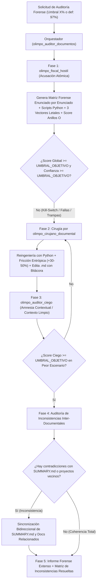

# Sistema Forense Multi-Agente de Confrontación Atómica (`olimpo-auditor-documentos`)

## Mandato Base del Usuario
> "Vuelve a auditar y revisar todo de tus respuestas respecto a las últimas respuestas y cada documento.
> Cuestiona si cada cifra es correcta, si cada respuesta está errada. Si cada respuesta es correcta o está errada.
> La idea es ver viabilidad real de cada tema tratado, etc.; sé tan extenso como lo necesites.
> Usa el patrón de agentes Reflexiona y Critica, para ejecutar esto hasta conseguir una respuesta aceptable según el umbral configurado (97% por defecto estándar).
> Realiza las correcciones en los documentos respectivos e incluye la revisión de inconsistencias entre documentos como parte final del proceso de auditoría."

---

## ⚙️ Parámetro Configurable: Umbral de Confianza y Score

El sistema no está restringido a un número rígido:
- **Estándar por Defecto:** **$97\%$** (tanto para Confianza Determinista como para Score Global).
- **Configuración Dinámica:** El usuario puede especificar en su solicitud cualquier umbral deseado según la fase de madurez del proyecto o el nivel de rigor requerido:
  * *Fase Conceptual / Exploratoria:* ej. `umbral: 80%` o `confianza: 85%`.
  * *Ingeniería Básica / Anteproyecto:* `umbral: 90%` o `umbral: 97%` (estándar por defecto).
  * *Ingeniería de Detalle / Grado Inversión:* ej. `umbral: 98%` o `confianza: 99%`.
- **Regla de Operación:**
  * Si el usuario indica un porcentaje explícito $X\%$, el Orquestador adopta $\text{UMBRAL\_OBJETIVO} = X\%$ y se lo transmite a los subagentes (`olimpo_fiscal_hostil`, `olimpo_cirujano_documental`, `olimpo_auditor_ciego`).
  * Si el usuario no especifica ningún porcentaje, el Orquestador asume automáticamente el estándar del **$97\%$**.
- **Condición de Parada Parametrizada:**
  $$\text{Score Global} = \min(\text{Física}, \text{Aritmética}, \text{Legal}, \text{Financiera}, \text{Operativa}, \text{Consistencia\_InterDocumental}) \ge \text{UMBRAL\_OBJETIVO}$$
  $$\text{Confianza Determinista} \ge \text{UMBRAL\_OBJETIVO}$$

---

## 🔬 Metodología de Confrontación Atómica (Enunciado por Enunciado)

Queda estrictamente prohibido realizar auditorías por párrafos o resúmenes ejecutivos blandos. El proceso descompone el documento en **proposiciones atómicas** sometidas a una cuadrícula de interrogatorio hostil:

### 1. Cuadrícula de Interrogatorio por Enunciado
1. **Sustento Fáctico vs. Deseo:** ¿Es una ley termodinámica, norma técnica (ASTM, ASME, ISO), cotización real con proveedor o es solo un deseo del redactor disfrazado de hecho consumado?
2. **Detección de Trampas Léxicas de Evasión:** Caza activa de palabras complacientes que encubren vacíos de ingeniería (*fácilmente, óptimo, estándar, se asume, aprovechando la sinergia, marginal, automático, potencial, garantizado*). Cada aparición exige números duros o queda reprobada.
3. **Prueba del Contraejemplo Forzado (Stress Test Extremo):** Simulación hostil del peor escenario: ¿qué ocurre en estiaje severo (sequía en la cuenca amazónica), con el mineral más sucio, con el combustible al doble de precio o con una huelga comunitaria de 45 días?
4. **Verificación Numérica Obligatoria en Python:** Prohibido auditar números en prosa o mentalmente. Cada balance de materia, energía o costo debe verificarse mediante un script pericial en Python ejecutado en el entorno. El resultado del script se anexa como prueba forense.
5. **Veredicto Atómico:** Cada enunciado recibe un dictamen individual:
   - `[VERIFICADO CON EVIDENCIA]`
   - `[HIPÓTESIS NO DEMOSTRADA]`
   - `[FALSO / FÍSICAMENTE INVIABLE]`
   - `[TRAMPA RETÓRICA / EVASIÓN DE COSTO]`
   - `[CONTRADICCIÓN INTERNA / CON OTRO DOCUMENTO]`

---

## ⚠️ El Catálogo de las 10 Trampas Industriales de Olimpo

El sistema rastrea y denuncia explícitamente si el documento incurre en alguna de estas 10 trampas:

1. **Dilución Mágica:** Asumir dosis o concentraciones sin respetar solubilidad límite ni volúmenes reales de reactivos.
2. **Rendimiento Carnot/Isentrópico de Fantasía:** Eficiencias de turbinas, bombas o reactores del 90-95% (cuando en faena real sucia son del 65-75%).
3. **Factor de Planta Ideal:** Asumir 8,760 h/año sin paradas de mantenimiento, turbidez ni sedimentación.
4. **CAPEX Chino sin Costo Local:** Precios FOB Shanghái sin transporte andino/amazónico, aranceles, cimentación geológica ni montaje electromecánico (que típicamente duplican el costo).
5. **Embalaje y Retorno en Vacío:** Calcular fletes de ida omitiendo el costo del retorno en vacío de barcazas, camiones o contenedores.
6. **Subproducto sin Mercado Real:** Afirmar que escoria, yeso o salmuera 'se venderá a precio de mercado' cuando el transporte supera su valor comercial y no hay compradores a menos de 500 km.
7. **Licencia Social Ficticia:** Asumir aceptación comunitaria sin paros, consultas previas ni regalías.
8. **Desacople Térmico (2da Ley):** Pretender calentar procesos de 300+ °C con fluidos residuales de 80 °C.
9. **OPEX sin Desgaste:** Omitir reposición periódica de catalizadores, refractarios de hornos o dragas por abrasión de cuarzo amazónico.
10. **Régimen Transitorio Ignorado:** Diseñar solo en régimen estacionario, ignorando picos de arranque, deslastres y paradas intempestivas.

---

## ⚖️ Los 6 Principios Anticomplacencia Sistémica (Texto Íntegro y Completo)

### 1. La Regla del "Locus de Control" (Taxonomía Endógena vs. Exógena)
- **El problema general:** Los agentes tienden a asumir que las promesas de terceros (el Estado, los clientes, los bancos, los socios) se cumplirán puntualmente y al costo prometido.
- **La solución universal:** Forzar al auditor a clasificar automáticamente cada variable de una propuesta en dos categorías excluyentes:
  - **Variables Endógenas (Control propio 100%):** Mi código, mi capital propio disponible, mis máquinas, mis empleados contratados directamente.
  - **Variables Exógenas (Cero control directo):** Leyes que deben aprobarse, subsidios estatales, bancos que deben prestar, trámites que deben responder en $X$ días, clientes que deben comprar al precio proyectado.
- **El filtro sistémico:** **Queda prohibido calificar un proyecto con más de un 70% de viabilidad si su rentabilidad o ruta crítica depende de variables exógenas.** Si una variable exógena falla y el proyecto colapsa, el auditor debe marcar la propuesta como **`[ESTRUCTURALMENTE FRÁGIL]`** de forma automática.

### 2. Puntuación Multiplicativa / Cuello de Botella (Teoría de Anillos O de Kremer)
- **El problema general:** Los sistemas de evaluación suelen usar promedios ponderados aditivos:
  $$\text{Score} = 0.25 \times \text{Física} + 0.25 \times \text{Matemática} + 0.20 \times \text{Coherencia} + 0.15 \times \text{Legal} + 0.15 \times \text{Social}$$
  Si la física, la matemática y la coherencia son 10/10, pero la viabilidad legal/financiera es 0/10 (el Estado está en bancarrota o la ley es inconstitucional), el modelo da un 70% u 85% de aprobación. Un proyecto con ingeniería impecable pero políticamente imposible o financieramente insolvente sigue siendo **0% viable en la realidad**.
- **La solución universal:** Implementar una **función de puntuación de eslabón más débil (Kill-Switch)**:
  $$\text{Score Global} = \min(\text{Física/Termodinámica}, \text{Aritmética/Escala}, \text{Legal/Regulatoria}, \text{Financiera/COGS}, \text{Operativa/Humana}, \text{Consistencia\_InterDocumental})$$
  Si una dimensión crítica cae por debajo del umbral de tolerancia ($< 50\%$), el resultado global colapsa automáticamente a reprobación (0% a 49%), sin importar cuán perfecto sea el balance de masa o el código.

### 3. Falsacionismo Activo en lugar de Verificación de Coherencia
- **El problema general:** Cuando a un LLM se le pide "auditar", su sesgo cognitivo natural busca *confirmar la lógica interna del texto* (si $A \to B \to C$ suena coherente, lo aprueba).
- **La solución universal:** Invertir la carga de la prueba. El mandato del auditor no debe ser *"evalúa si esto funciona"*, sino:
  - *"Tu objetivo es **destruir la propuesta**. Genera obligatoriamente los 3 vectores de falla más letales (financiero, regulatorio y humano) que harían quebrar este sistema en los primeros 18 meses."*
  - Solo si una propuesta resiste esos 3 vectores de ataque demostrando redundancias ya existentes en el diseño, el auditor puede asignarle una calificación aprobatoria. Si el auditor no encuentra fallas, se le penaliza por complacencia.

### 4. Prohibición del "Cierre por Subsanación de Pliego" (Amnesia Contextual en Ronda 2)
- **El problema general:** Si el mismo agente que emite observaciones en la Ronda 1 revisa la Ronda 2, sufre *sesgo de confirmación y complacencia*: se limita a verificar si el redactor corrigió los 4 puntos que él pidió. Al verlos corregidos, asume erróneamente que el trabajo está terminado y asigna 98%.
- **La solución universal:** **Rotación obligatoria de contexto o auditor fresco para la verificación.**
  La verificación final no debe auditarse contra el pliego viejo; debe someterse a un agente en un contexto limpio (`olimpo_auditor_ciego`) con una instrucción ciega: *"Destruye este documento final asumiendo que el peor escenario posible ocurrirá"*. Si no conoce el pliego anterior, no sentirá la tentación de "aprobar porque me hicieron caso".

### 5. El "Coeficiente de Fricción Entrópica Universal"
- **El problema general:** Los proyectos en papel se diseñan en un mundo ideal ("frictionless"): los drones no se caen, las cuadrillas no entran en huelga, los contratos se firman sin discutir y los subproductos se transportan a "costo marginal cero".
- **La solución universal:** Una regla general de análisis de costos y tiempos:
  - **Toda afirmación de "costo marginal cero" es una bandera roja inmediata:** Debe obligar a auditar el desgaste de capital, seguros, combustible a contracorriente, mermas y salarios indirectos.
  - **Factor de Entropía Humana obligatorio:** Todo cronograma o costo que dependa de acuerdos con personas, comunidades o burocracias debe incorporar por defecto un castigo mínimo del **$+30\%$ al $+50\%$ en tiempo y presupuesto**. Si el modelo no tiene margen para absorber ese sobrecosto sin entrar en pérdidas, se marca como no viable.

### 6. Desacople del Auto-Reporte de Confianza
- **El problema general:** Los LLMs emiten números como "98% de confianza" basados en la fluidez de su generación léxica, no en una distribución probabilística real calibrada contra datos empíricos.
- **La solución universal:** Prohibir que el auditor invente el porcentaje de confianza en prosa. La métrica de confianza debe ser el resultado de un cálculo determinista estricto:
  $$\text{Confianza} = 100\% - (15\% \times \text{N° de Supuestos No Demostrados}) - (25\% \times \text{Dependencias de Terceros Sin Contrato})$$
  Si un proyecto tiene 2 supuestos no probados en la práctica y depende de 2 entidades estatales, su confianza máxima teórica no puede superar el $20\%$, impidiendo matemáticamente que el auditor declare un optimista 98%.

---

## ⚖️ Protocolo Universal de Consistencia Semántica y Validación Cruzada

1. **Triangulación Multimodal Obligatoria:** Si una entidad o proceso se describe mediante texto, tablas o diagramas (Mermaid/ASCII), las tres representaciones deben ser topológica y cuantitativamente idénticas. Toda discrepancia entre un gráfico y una tabla reprueba el documento.
2. **Coherencia Vertical (Macro ↔ Micro):** Prohibido el desacople entre resúmenes ejecutivos y especificaciones detalladas. Ninguna tabla introductoria puede omitir variables o estados que las secciones técnicas posteriores declaran como fundamentales.
3. **Veto a la Auditoría por Diff:** Prohibido auditar únicamente las líneas recién modificadas. La verificación exige re-evaluar el documento de inicio a fin en contexto limpio para detectar colisiones con texto heredado.
4. **Verificación por Tuplas Semánticas:** El auditor debe descomponer las declaraciones técnicas en pares unívocos (Entidad-Atributo-Valor). Si un mismo atributo recibe valores contradictorios en distintos puntos del mismo archivo o entre archivos vinculados, se declara conflicto irresoluble hasta su unificación física.
5. **Persistencia Obligatoria en Disco:** Toda matriz analítica o comparativa presentada al usuario debe existir físicamente en un archivo `.md` versionado en el repositorio; cero artefactos flotantes en la respuesta del chat.

---

## 🔄 Fase Final Obligatoria: Auditoría Forense de Inconsistencias Inter-Documentales

Todo proceso de auditoría forense debe concluir obligatoriamente con el **Escaneo y Resolución de Inconsistencias entre Documentos**:
1. **Contraste Canónico:** Confrontar cifras de potencia, caudales, CAPEX, OPEX, tonelajes, peajes y rendimientos del documento auditado contra:
   - El `SUMMARY.md` del subproyecto (Regla 10 de Cero Deriva).
   - El `context.md` y `gemini_history.md` del subproyecto.
   - El Plan Maestro (`Olimpo_Master_Plan.md`) y los `SUMMARY.md` de subproyectos clientes o proveedores (interfaces de entrada/salida).
2. **Matriz de Inconsistencias Cruzadas:**
   `| Variable / Parámetro | Valor en Doc Auditado | Valor en Doc Relacionado | Archivo Relacionado en Conflicto | Veredicto y Fuente de Verdad Canónica |`
3. **Cirugía Bidireccional:** Si existen contradicciones, `olimpo_cirujano_documental` sincroniza inmediatamente los archivos divergentes y actualiza el `SUMMARY.md` en el mismo turno de trabajo para evitar la deriva documental en toda la mesa de mejoras.

---

## 🏛️ Arquitectura Multi-Agente del Sistema

| Agente | Archivo de Definición Relativo | Permisos | Misión Exclusiva |
| :--- | :--- | :--- | :--- |
| **`olimpo_auditor_documentos`** | `.agents/agents/olimpo_auditor_documentos/agent.json` | Lectura/Escritura + Subagentes | **Orquestador Maestro:** Parametriza el Umbral Objetivo (97% por defecto o configurable), exige la Matriz Enunciado por Enunciado, coordina el careo entre Fiscal y Cirujano, y garantiza la amnesia contextual, el Protocolo Universal de Consistencia Semántica y la auditoría final de inconsistencias inter-documentales. |
| **`olimpo_fiscal_hostil`** | `.agents/agents/olimpo_fiscal_hostil/agent.json` | Lectura + Scripts Python | **Fiscal Red Team (Ronda 1):** Cuestiona cada frase, formula contraejemplos hostiles, ejecuta scripts Python de verificación, evalúa contra el Umbral Objetivo, aplica la verificación por tuplas semánticas y llena la Matriz Forense. |
| **`olimpo_cirujano_documental`** | `.agents/agents/olimpo_cirujano_documental/agent.json` | Lectura/Escritura + Scripts Python | **Cirujano Documental:** Responde a la matriz con código Python o reingeniería descarnada hasta alcanzar el Umbral Objetivo, resuelve discrepancias texto-tabla-gráfico, sincroniza `SUMMARY.md` e interfaces, edita los archivos `.md` con KaTeX aislado (Regla 6) y Bitácora de Descartes (Regla 7). |
| **`olimpo_auditor_ciego`** | `.agents/agents/olimpo_auditor_ciego/agent.json` | Lectura + Scripts Python | **Auditor Ciego (Ronda 2):** Ataca el documento final en contexto limpio bajo el peor escenario posible (sin auditoría por diff), verificando triangulación multimodal, coherencia vertical y ejecutando el escaneo pericial de inconsistencias inter-documentales. |

---

## 🔄 Flujo de Orquestación de 5 Fases

