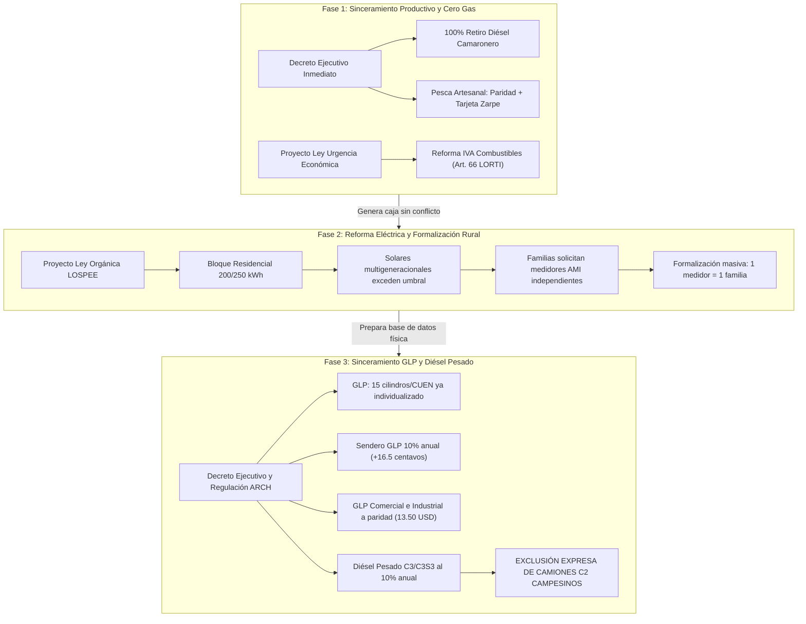

# Auditoría Forense de Resistencia Política ante la CONAIE y Hoja de Ruta Secuencial en Tres Fases

> **Consorcio Industrial Kronos — Red Team de Viabilidad Sociopolítica y Técnica Legislativa**  
> *Documento Canónico de Auditoría, Autocrítica y Rediseño Táctico — Proyecto Reformas Ecuador*  
> *En cumplimiento de los Mandamientos 1 (No Complacencia), 3 (Realismo Estricto), 4 (Realidad Experimental Empírica), 5 (KaTeX Aislado), 6 (Bitácora de Decisiones y Descartes) y 8 (USD como Base).*

---

## 1. Misión y Propósito del Documento

El presente informe constituye una auditoría forense sin complacencia del paquete de reformas a los subsidios de combustibles frente a la capacidad de movilización y veto territorial de la **Confederación de Nacionalidades Indígenas del Ecuador (CONAIE)** y sus estructuras aliadas (ECUARUNARI, CONFENIAE, FEINE, FENOCIN y cooperativas de transporte rural de la Sierra Centro).

A partir de la confrontación empírica con los paros nacionales de octubre de 2019, junio de 2022 y la transición de gasolinas de junio de 2024, este documento identifica las fallas críticas de laboratorio del diseño original y formula la **Hoja de Ruta Secuencial en Tres Fases e Instrumentos Legales Diferenciados**, articulando la reforma eléctrica previa como el mecanismo catalizador indispensable para individualizar medidores en el campo antes de aplicar los límites al gas doméstico.

---

## 2. Auditoría Forense y Autocrítica Técnica sin Complacencia

### 2.1. Confrontación Empírica Histórica (2019 vs. 2022 vs. 2024)

Cualquier propuesta que ignore la física social y la geografía del conflicto en el Ecuador está condenada a ser derogada en las calles.

| Evento Histórico | Medida Adoptada | Reacción Sociopolítica | Desenlace Operativo | Lección Inviolable para el Diseño Kronos |
| :--- | :--- | :--- | :--- | :--- |
| **Octubre 2019 (Decreto 883 - Moreno)** | Shock frontal: subida inmediata del 123% en Diésel (1.03 a 2.30 USD) y Gasolinas de la noche a la mañana. | Paro Nacional de 11 días; toma de Quito, quema de la Contraloría, parálisis total de la E35 y pozos petroleros amazónicos. | **Derogatoria total del Decreto 883.** El gobierno quedó al borde de la disolución. | Los shocks simultáneos en diésel y transporte unifican de inmediato a los transportistas y a la CONAIE en un solo bloque destructivo. |
| **Junio 2022 (Paro de 18 Días - Lasso)** | Bandas móviles acumuladas (Diésel a 1.90 USD). Negativa a subsidiar insumos agrícolas o crédito. | Paro Nacional de 18 días liderado por Leonidas Iza; pérdidas superiores a 1,000 M USD. | **Capitulación parcial del Estado.** Rebaja de 15 centavos y colapso de las mesas de diálogo técnico. | La CONAIE rechaza filtros bancarios, formularios web o cruces de bases de datos del SRI que percibe como exclusión burocrática del campesinado. |
| **Junio 2024 (Decreto 308 - Noboa)** | Paridad en Extra y Ecopaís con compensación bancaria a taxis y camionetas. **CERO toque a Diésel y GLP.** | Amenazas retóricas de paro; marchas aisladas en Quito sin poder de convocatoria comunitaria. | **Éxito total.** Cero días de paro; subsidio a gasolinas desmontado pacíficamente. | La base comunitaria campesina no consume Extra: cocina con GLP y se moviliza con Diésel. Si no se tocan esos dos insumos sin blindaje previo, no hay paro nacional. |

---

### 2.2. Las Tres Vulnerabilidades Críticas de Laboratorio Identificadas

La auditoría Red Team determina que, aunque el paquete modular propuesto es infinitamente superior a los errores de 2019 y 2022, adolece de tres fallas sociológicas que la dirigencia indígena explotará en el terreno si no se corrigen:

```
[VULNERABILIDAD 1: EL SOLAR RURAL MULTIGENERACIONAL]
Un medidor eléctrico compartido (CUEN) ---> 3 a 4 familias campesinas (12 a 16 personas)
Tope del modelo: 15 cilindros/año (1.25 cilindros/mes)
Consumo agregado real del predio: 35 a 45 cilindros/año
Falla en Mes 5: El sistema bloquea el cupo y exige 13.50 USD por cilindro en efectivo.
Reacción: Asamblea comunitaria inmediata y bloqueo de la Panamericana Sur (E35).
```

#### Falla 1: La Trampa del Solar Rural Multigeneracional
* **El Supuesto Teórico:** Quince cilindros al año por medidor residencial (CUEN) cubren el 148% de la demanda promedio de una familia estándar de 4 miembros (10 a 12 cilindros/año).
* **La Realidad Andina:** En las comunidades de Cotopaxi, Chimborazo, Tungurahua e Imbabura predomina el solar familiar indiviso. En un mismo terreno con un único medidor eléctrico suelen residir los abuelos y dos o tres hijos casados con sus respectivas familias, cocinando en fogones separados.
* **El Quiebre:** Quince cilindros para cuatro familias equivalen a menos de 4 cilindros al año por hogar (menos de uno cada 90 días). Hacia abril o mayo, el cupo anual se habrá agotado. Al ir a comprar el cilindro número 16 para el almuerzo y encontrar que el sistema telemático exige 13.50 USD en lugar del precio oficial subsidiado, el comunero no tramitará un reclamo administrativo: acudirá al Cabildo Comunal, se activará la justicia indígena y se declarará el cierre de vías provinciales.

#### Falla 2: El Chofer Comunitario de Carga Media (Camiones C2 de Dos Ejes)
* **El Supuesto Teórico:** El sendero del 10% en diésel se compensa con la cláusula obligatoria de pase de flete a los grandes dadores de carga (empresas industriales y cadenas de supermercados).
* **La Realidad Andina:** Miles de pequeños camiones de dos ejes (categoría C2, de 5 a 10 toneladas) pertenecen a comuneros, cooperativas rurales indígenas y asociaciones agrícolas campesinas (afiliadas a FENOCIN, FEINE o filiales de la CONAIE). Son los vehículos que transportan la papa de Colta, la leche de Machachi, la cebolla de Tungurahua y el brócoli hacia los mercados mayoristas de San Roque y Ambato.
* **El Quiebre:** Los dadores de carga en las ferias rurales no son corporaciones formales sino comerciantes informales intermediarios que no aceptan contratos con cláusulas de indexación. El chofer indígena absorberá el incremento del combustible o se lo trasladará al productor en la chacra, convirtiendo al transportista rural en el brazo logístico de la movilización indígena.

#### Falla 3: La Especulación del Fletero Privado de Gas
* **El Supuesto Teórico:** El precio oficial en depósito pasa de 1.65 a 1.815 USD en el Año 1 (+16.5 centavos).
* **La Realidad Andina:** En las comunidades rurales y parroquias apartadas, los camiones distribuidores privados ya cobran 4.00 a 5.00 USD por cilindro entregado en domicilio.
* **El Quiebre:** Al subir el precio oficial en 16.5 centavos, el fletero rural redondeará abusivamente a 5.50 o 6.00 USD, aduciendo que "el gobierno subió el gas". Si no existe una red pública que garantice el precio oficial exacto en territorio, la especulación privada encenderá el malestar social.

---

## 3. Hoja de Ruta Secuencial en Tres Fases (Desacoplamiento Táctico)

Para garantizar la viabilidad absoluta y desmantelar el poder de veto de la CONAIE, la implementación no debe ejecutarse en un solo acto legislativo masivo, sino a través de **tres instrumentos diferenciados en el tiempo**:



---

### Fase 1: Sinceramiento Productivo, Blindaje Moral y Captura Inmediata de Caja

* **Horizonte Temporal:** Mes 1 (Implementación inmediata).
* **Instrumento Legal:**
  1. **Decreto Ejecutivo Directo:** Modificación a los Decretos Ejecutivos 675 y reglamentación de precios de derivados hidrocarburíferos (Art. 72 Ley de Hidrocarburos).
  2. **Proyecto de Ley de Urgencia Económica (Trámite 30 días):** Reforma al Art. 66 de la LORTI sobre deducibilidad de IVA en combustibles.
* **Medidas Adoptadas:**
  1. **Diésel Camaronero al 100% de Paridad Internacional:** Derogatoria inmediata de la excepción de 30 hectáreas. Cruce telemático con DAEs de SENAE (+75.00 M USD/año).
  2. **Pesca Artesanal:** Cobro a paridad en surtidor marino para quebrar el arbitraje narco; compensación anticipada por zarpe DIRNEA en Tarjeta Prepago BanEcuador con 1 año de gracia y reducción del 10% anual; crédito CFN para motores 4T y transpondedores AIS obligatorios gratuitos (+50.00 M USD/año a término).
  3. **Reforma al IVA en Combustibles:** Prohibición taxativa de usar el IVA de combustibles fósiles como crédito tributario para ventas (+135.00 M USD/año). Cero incremento en surtidor.
  4. **CERO TOQUE AL TANQUE DE GAS (GLP) Y CERO TOQUE AL TRANSPORTE TERRESTRE.**
* **Alivio Fiscal Inmediato Fase 1:** **+210.00 M USD/año** netos desde el primer día.
* **Resistencia Política ante CONAIE:** **10 / 10 (Inmune).** La CONAIE no puede movilizar sus bases para defender subsidios al gran sector camaronero ni al crédito fiscal de corporaciones. Se despoja a la dirigencia de su argumento discursivo de "gobierno pro-empresarial".

---

### Fase 2: Reforma Eléctrica como Motor de Individualización de Medidores

* **Horizonte Temporal:** Meses 2 a 8.
* **Instrumento Legal:** Proyecto de Ley Orgánica Reformatoria a la LOSPEE (aprobación legislativa o ministerio de la ley).
* **El Mecanismo Catalizador de Formalización:**
  1. La reforma fija un bloque protegido de **200 kWh/mes base** y **250 kWh/mes con cocina de inducción** a tarifa subsidiada económica (~0.095 USD/kWh).
  2. Todo consumo mensual por encima de 250 kWh se factura a **costo real pleno (~0.18 USD/kWh) más el Factor de Costo de Contingencia (FCC de 2 centavos en estiaje)**.
  3. **El Efecto Económico Inducido en el Solar Rural:** En los predios rurales donde cohabitan 3 o 4 familias bajo un solo medidor, el consumo agregado oscila entre 350 y 600 kWh/mes. Bajo el nuevo régimen, la planilla unificada saltará bruscamente de 25-35 USD a **75-125 USD/mes**.
  4. **Respuesta Racional de las Familias Campesinas:** En lugar de pagar tarifas de castigo suntuario, los hogares del solar solicitarán de forma voluntaria e inmediata a CNEL EP o a la empresa eléctrica local la **instalación de medidores independientes (AMI)** para cada vivienda, dividiendo la carga para que cada familia compute menos de 200 kWh/mes.
  5. La ley establece que el depósito de garantía del medidor (Costo + 10% = ~65 USD) se financia en 36 cuotas sin intereses en la planilla (**~1.80 USD/mes**).
* **Resultado Estratégico:** Sin censos burocráticos ni gasto estatal, la reforma eléctrica **individualiza, georreferencia y asigna un código CUEN exclusivo a cada familia rural** en un lapso de 6 meses. La vulnerabilidad del "solar multigeneracional" queda resuelta de raíz en el plano físico antes de tocar el gas.

---

### Fase 3: Sinceramiento del GLP y Transporte Pesado Calibrado

* **Horizonte Temporal:** Meses 9 en adelante (con parque de medidores ya depurado).
* **Instrumento Legal:** Decreto Ejecutivo y Resoluciones Regulatorias de la ARCH y el Ministerio de Transporte y Obras Públicas.
* **Medidas Adoptadas:**
  1. **Cupo de 15 Cilindros/Año por CUEN Residencial:** Como cada familia del solar ya cuenta con su propio medidor individual instalado en la Fase 2, los 15 cilindros anuales asignados por CUEN cubren con holgura los 10 a 12 cilindros de consumo real unifamiliar (148% de cobertura). Nadie cae en la tarifa comercial de 13.50 USD para cocinar en su hogar.
  2. **Sendero Suave del 10% Anual Compuesto en GLP:** Incremento reglado de +16.5 centavos el primer año (1.65 a 1.815 USD), +18 centavos el segundo año (1.996 USD), hasta paridad en 22 años (+11.51 M USD en Año 1, +70.20 M USD en Año 5).
  3. **Desmonte Inmediato del Subsidio en GLP Comercial e Industrial:** Hoteles, restaurantes, saunas, pollerías y calderas pagan 100% paridad (13.50 USD/cilindro) desde el Día 1 (+180.00 M USD/año).
  4. **Los Cuatro Candados Anti-Fraude Activos:** Cadencia temporal de 20 días, canje físico 1:1 con SMS de alerta, consumo eléctrico mínimo de 15 kWh/mes y geocercas GPS en camiones repartidores.
  5. **Sendero del 10% Anual en Diésel Pesado con Exclusión Expresa Campesina:**
     * El ajuste del 10% anual (+17.5 centavos/galón en Año 1) aplica **estrictamente a camiones pesados C3 (tres ejes) y tractocamiones articulados C3S2 y C3S3** pertenecientes a empresas formales y flotas de carga interprovincial.
     * **Exclusión Expresa:** Los camiones rígidos livianos y medianos **C2 (dos ejes, hasta 8-10 toneladas de capacidad)** registrados en cooperativas de transporte mixto rural y producción campesina lechera/hortícola quedan **congelados a 1.75 USD/galón**, junto al transporte público de pasajeros.
     * Cláusula obligatoria de flete al cargador y arancel 0% en neumáticos radiales pesados y filtros para las flotas pesadas.
* **Alivio Fiscal Consolidado Fase 3:** **+412.01 M USD adicionales en Año 1**, totalizando los **+622.01 M USD/año** netos (19.75% del déficit total del PGE) y escalando a **+2,324.00 M USD/año en el Año 6+** (73.78% del déficit).

---

## 4. Mapeo Constitucional y Competencia Legal de los Instrumentos

| Fase / Materia | Instrumento Idóneo | Base Constitucional y Legal | Trámite Requerido | Riesgo de Bloqueo Político |
| :--- | :--- | :--- | :--- | :--- |
| **Fase 1: Diésel Camaronero y Pesca** | Decreto Ejecutivo Presidencial | Art. 72 Ley de Hidrocarburos; Arts. 147 numerales 5 y 13 CRE. | Firma del Presidente y publicación en Registro Oficial (inmediato). | **Nulo.** Facultad privativa del Ejecutivo sobre fijación de precios de derivados. |
| **Fase 1: Reforma IVA Combustibles** | Proyecto de Ley de Urgencia Económica | Art. 140 CRE; Art. 301 CRE (competencia tributaria exclusiva del Presidente). | Calificación CAL, trámite de 30 días en Asamblea Nacional o vigencia por ministerio de la ley. | **Bajo-Medio.** Fácil aprobación o vigencia tácita sin costo social popular. |
| **Fase 2: Ley Subsidios Eléctricos** | Proyecto de Ley Orgánica (LOSPEE) | Art. 133 CRE; Arts. 313 y 314 CRE (sectores estratégicos y servicios públicos). | Comisión de Desarrollo Económico, dos debates en el Pleno. | **Medio.** Altamente defendible: protege a 879 GWh/mes prioritarios y combate apagones. |
| **Fase 3: Regulación GLP y Cupos CUEN** | Decreto Ejecutivo y Resolución ARCH | Art. 72 Ley de Hidrocarburos; reglamentación de comercialización de GLP. | Emisión de pliegos conjuntos ARCH-ARCONEL y parametrización de software. | **Nulo en lo formal.** Requiere blindaje operativo en territorio. |
| **Fase 3: Diésel Pesado C3 y Aranceles** | Decreto Ejecutivo y Resolución COMEX | Art. 305 CRE; Código Orgánico de la Producción (COPCI). | Resolución del Pleno del COMEX para arancel 0% en llantas y Decreto Ejecutivo para tarifa diésel C3. | **Nulo en lo formal.** Respaldo del gremio pesado por pase de flete. |

---

## 5. Los Fusibles Territoriales Obligatorios en el Páramo Andino

Para neutralizar cualquier conato de agitación comunitaria durante la Fase 3, el Estado debe desplegar dos mecanismos de amortiguamiento directo:

### Fusible A: Red Pública de Abastecimiento GLP a Precio Oficial ($1.815 USD)
* Convenio operativo entre Petroecuador, las Fuerzas Armadas y los Gobiernos Parroquiales Rurales para mantener **puntos fijos de despacho en las cabeceras parroquiales del páramo**.
* El cilindro se despacha contra presentación de la planilla eléctrica pagada al precio oficial exacto en efectivo o canje biométrico, erradicando el cobro especulativo de 5.00 a 6.00 USD por parte de fleteros informales.

### Fusible B: Principio "Dólar por Dólar" para el Campo (Crédito al 1% y Riego Andino)
* La ley consagra que de los recursos liberados por el retiro de subsidios a los camaroneros y al GLP comercial:
  1. Se asignan de forma fija **60.00 M USD/año** para subsidiar el fondeo de **BanEcuador en líneas de microcrédito al 1% de interés anual hasta 30 años plazo** (montos de hasta 5,000 USD) para pequeños agricultores comunales.
  2. Se transfieren de forma automática **40.00 M USD/año** a los Gobiernos Provinciales de la Sierra Centro y Amazonía con destino exclusivo a **obras de revestimiento y tecnificación de canales de riego comunitario**.
* *Efecto Político:* Quien convoque a un paro estará bloqueando los recursos para el riego y el crédito de sus propias comunidades.

---

## 6. Bitácora Forense de Decisiones, Ajustes y Descartes

En cumplimiento estricto del Mandamiento 6 de la Doctrina Kronos, se registran los motivos técnicos de las decisiones tomadas y las alternativas descartadas:

| Alternativa Evaluada | Decisión | Pros Identificados | Contras y Trade-offs | Justificación Técnica Exacta del Descarte |
| :--- | :--- | :--- | :--- | :--- |
| **Aplicación Simultánea de GLP, Diésel y Electricidad en un Solo Decreto-Ley** | **Descartada** | Ahorro fiscal bruto superior a 1,200 M USD en el Mes 1. | Aglutina a la CONAIE, transportistas y usuarios residenciales en una sola plataforma de protesta; alta probabilidad de caída del gobierno. | Descartada por suicidio político y operativo. La historia empírica de 2019 demuestra que las medidas agregadas detonan paros incontrolables. |
| **Excepción al Diésel Camaronero para Proteger Fincas Pequeñas (<30 ha)** | **Descartada** | Simpatía con pequeños acuicultores del golfo. | Abre una compuerta masiva de elusión mediante subdivisión artificial de predios; perpetúa contrabando de 40M galones. | Descartada. Los pequeños camaroneros se benefician más al electrificarse (ahorro de 50.2% en bombeo vs diésel a costo real). |
| **Inclusión de Camiones C2 Campesinos en el Sendero del 10% de Diésel** | **Descartada** | Recaudación adicional de ~65 M USD/año. | El chofer de carga pequeña rural es comunero indígena; traslada el alza al costo del flete de la papa/leche; reactiva la alianza transportistas-CONAIE. | Descartada. Es un fusible político de alta rentabilidad estratégica: se preserva la paz social en la Sierra Centro sacrificando un monto fiscal marginal. |
| **Cupo de GLP Basado Exclusivamente en Cédula de Identidad** | **Descartada** | Supuesta cobertura individual a cada ciudadano. | Multiplica los cupos a más de 10 millones; incentiva mafias de compra y acopio de cédulas; no refleja la termodinámica del hogar. | Descartada. El subsidio debe anclarse a la cocina física y a la vivienda real. |
| **Secuenciamiento en Tres Fases con la Reforma Eléctrica como Catalizador de Medidores** | **Aprobada** | Desarticula la coalición opositora; da 6 meses para que los solares rurales instalen medidores AMI independientes; garantiza legitimidad moral en Fase 1. | Requiere coordinación interinstitucional estricta y una ejecución disciplinada en el calendario. | Aprobada como la única arquitectura técnica, jurídica y políticamente viable para erradicar los subsidios en el Ecuador con cero días de paro. |

---

## 7. Balance Financiero Secuencial Consolidado

A continuación se presenta el perfil de ingresos fiscales netos garantizados a lo largo de las tres fases de ejecución:

| Periodo / Fase | Instrumento Principal | Hito Regulatorio | Alivio Fiscal Anual (USD) | Participación sobre Déficit PGE (-3,150 M USD) |
| :--- | :--- | :--- | :--- | :--- |
| **Fase 1 (Mes 1)** | Decreto Ejecutivo + Ley Urgencia IVA | Diésel camaronero 100% + Pesca + IVA combustibles | **+210.00 M USD** | 6.67% |
| **Fase 2 (Meses 2-8)** | Ley Orgánica Eléctrica (LOSPEE) | Ahorro fiscal eléctrico neto + Individualización de medidores AMI | **+3,090.00 M USD** *(Sector Eléctrico)* | Absorbe déficit tarifario y contingencias térmicas |
| **Fase 3: Año 1** | Decreto Ejecutivo GLP / Diésel C3 | 15 cilindros/CUEN + GLP Comercial + Diésel Pesado C3 (+10%) | **+622.01 M USD** *(Combustibles)* | 19.75% del déficit PGE |
| **Fase 3: Año 3** | Ejecución continuada senderos | GLP al 10% compuesto + Diésel C3 al 10% compuesto + Fin Decreto 308 | **+1,224.62 M USD** | 38.88% del déficit PGE |
| **Fase 3: Año 6+** | Régimen permanente estabilizado | Paridad WTI en transporte pesado + GLP comercial + Capping 0 | **+2,324.00 M USD** | **73.78% del déficit liquidado** |

---

### Verificación Pericial Final

El presente documento queda formalmente incorporado al acervo canónico del proyecto Reformas Ecuador como la directriz maestra de secuenciamiento legislativo e implementación política. Cualquier modificación a los plazos, umbrales o exclusiones de flotas deberá ser reflejada en el archivo `SUMMARY.md` y someterse a la validación estricta de los 12 Mandamientos Inviolables de Kronos.
