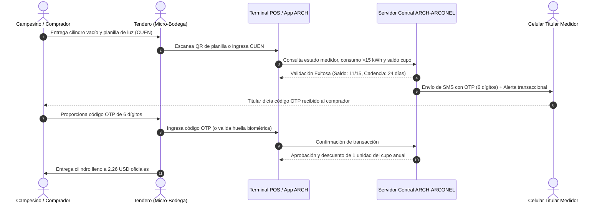

# Estrategia de Despliegue de Micro-Bodegas Rurales de GLP y Protocolo de Verificación 2FA por Medidor Eléctrico (CUEN)

> **Consorcio Industrial Kronos — Manual de Operaciones y Estándar Tecnológico Antifraude**  
> *Subproyecto de Subsidios a los Combustibles — Proyecto Reformas Ecuador*  
> *Código de Estándar:* `KRN-GLP-2FA-CUEN-2026`  
> *Sujeto a la Doctrina Mandatoria de Operación (AGENTS.md) — Mandamientos 1, 3, 4, 5, 6 y 8.*

---

## 1. Misión y Propósito Operativo

El presente documento formaliza la estrategia logística para garantizar la disponibilidad permanente de cilindros de Gas Licuado de Petróleo (GLP) doméstico al precio oficial regulado en cada poblado, parroquia y caserío rural del Ecuador, integrando la arquitectura de **Micro-Bodegas Comunitarias de GLP** con el **Protocolo Criptográfico de Doble Factor de Autenticación (2FA) por Código Único Eléctrico Nacional (CUEN)**.

Este sistema destruye el monopolio geográfico de los camiones fleteros privados que hoy cobran entre 4.50 y 5.50 USD por cilindro en zonas de difícil acceso, y establece un blindaje digital de alta seguridad que erradica el tráfico de cédulas, el contrabando fronterizo y el desvío ilícito hacia calderas, restaurantes y vehículos.

---

## 2. Estrategia de Cobertura Territorial: Red de Micro-Bodegas en Cada Poblado

```
                   CADENA DE DISTRIBUCIÓN CAPILAR Y PRECIOS
┌────────────────────────────────────────────────────────────────────────┐
│ 1. Terminal Envasadora Petroecuador / Eni / Duragas: 1.815 USD (Año 1) │
│    ↓ Flete mayorista en bloque a centros cantonales: +0.150 USD        │
│ 2. Micro-Bodega Comunitaria en Poblado / Parroquia: 1.965 USD recepción│
│    ↓ Margen regulado de mostrador para el tendero: +0.300 USD          │
│ 3. PVP Oficial de Mostrador pagado por el campesino: 2.265 USD         │
│    ↓ Transporte autónomo campesino (Mula / Caballo / Moto / Bici)      │
│ 4. Hogar Rural en la Chacra / Páramo: Ahorro de más del 50% en flete  │
└────────────────────────────────────────────────────────────────────────┘
```

### 2.1. Densidad y Ubicación de los Puntos de Venta
* **Criterio de Cobertura Radial:** Se habilita al menos **una Micro-Bodega por cada cabecera parroquial rural y por cada poblado satélite de más de 250 habitantes**, garantizando que ninguna comunidad campesina esté a más de 3 a 8 kilómetros de un punto oficial de despacho.
* **Operadores Locales Seleccionados:**
  1. Tiendas de abarrotes de barrio y ferreterías tradicionales del pueblo.
  2. Oficinas de atención de Cooperativas de Ahorro y Crédito Indígenas y Rurales (*Mushuc Runa*, *Jardín Azuayo*, *Riobamba*, *Guaranda*).
  3. Almacenes agropecuarios comunitarios administrados por las Juntas Parroquiales Rurales o Cabildos Comunitarios.

### 2.2. Obligación Contractual de Abastecimiento Mayorista Ininterrumpido
* **Condición Resolutoria a Envasadoras y Distribuidores:** Petroecuador y las empresas envasadoras autorizadas (Duragas, Congas, Eni) incorporan en sus contratos de concesión la **obligación inexcusable de abastecer semanalmente los pedidos de las micro-bodegas rurales registradas**, despachando el cupo solicitado al precio mayorista oficial (1.965 USD puesto en local).
* **Mecanismo de Alerta por Desabastecimiento:** Si un camión repartidor se niega a descargar en la micro-bodega autorizada para forzar la venta ambulante a sobreprecio en la carretera, el comerciante o la Junta Parroquial presiona el botón de denuncia en la app del terminal POS. La ARCH suspende de forma inmediata el cupo de combustible subsidiado asignado al camión infractor.

### 2.3. Infraestructura Física de Seguridad: Jaula Metálica Exterior Homologada
Para evitar la clausura por parte del Cuerpo de Bomberos bajo la rígida Norma INEN 2260 y proteger al tendero contra acusaciones de acopio penal bajo el Art. 264 del COIP:
* **Capacidad Autorizada:** 30 a 60 cilindros de 15 kg (ampliable a 100 cilindros en parroquias grandes).
* **Ubicación Exclusiva:** Patio exterior, retiro lateral ventilado o acera del local comercial (**estrictamente prohibido dentro de habitaciones cerradas con víveres**).
* **Especificaciones Constructivas:**
  * Estructura de malla electrosoldada galvanizada calibre 10 con perfiles tubulares de acero de 2 pulgadas.
  * Techo de chapa de zinc con pendiente para lluvia y piso de hormigón no chispeante.
  * Puerta con portacandado de alta seguridad y cerradura blindada.
  * Extintor de polvo químico seco (PQS) de 20 libras tipo ABC y letrero reglamentario *"Prohibido Fumar / Peligro Gas Inflamable"*.
* **Licenciamiento Simplificado Express:** Permiso de funcionamiento emitido por el Ministerio de Energía y Bomberos vía web en 48 horas mediante declaración juramentada del comerciante, exento de tasas abusivas.

---

## 3. Protocolo de Verificación en Dos Pasos (2FA) por Código CUEN

El corazón del sistema es la vinculación del subsidio a la vivienda física mediante el **Código Único Eléctrico Nacional (CUEN)** del medidor residencial, combinado con un segundo factor de autenticación transaccional en tiempo real.



---

### 3.1. Paso 1: Validación Primaria Telemática de la Cuenta Eléctrica

El comprador presenta su planilla de luz (en papel o digital) o indica el número de medidor (CUEN). El terminal POS o smartphone del tendero ejecuta las siguientes verificaciones automáticas en la base unificada ARCH-ARCONEL-SRI:

1. **Filtro de Tarifa Residencial Activa:**  
   Verifica que el CUEN corresponda a un suministro eléctrico de categoría residencial unifamiliar. Quedan excluidos medidores comerciales, industriales, canchas deportivas y bombeo de agua.
2. **Filtro de Consumo Mínimo Real ($\ge 15\text{ kWh/mes}$):**  
   Comprueba telemáticamente que el medidor registre un consumo activo promedio en los últimos 3 meses no menor a 15 kWh/mes.  
   *Objetivo:* Erradica de cuajo los "medidores fantasma", lotes baldíos, casetas deshabitadas o tomas clandestinas dadas de alta por mafias para acumular cupos de gas.
3. **Control del Saldo Anual (Tope de 15 Cilindros/Año):**  
   Verifica que el suministro disponga de cupo remanente dentro del año calendario (enero a diciembre). Si el cupo se agotó (cilindro 16 en adelante), el sistema no autoriza el precio subsidiado y conmuta automáticamente al precio de paridad plena (13.50 USD).
4. **Candado de Cadencia Temporal No Acumulable (Mínimo 20 Días):**  
   Calcula la diferencia de días entre la fecha actual y la última compra registrada bajo ese mismo CUEN. Si han transcurrido menos de 20 días calendario, el sistema rechaza la transacción subsidiada.  
   *Objetivo:* Impide que un intermediario compre los 15 cilindros del año en una sola semana para contrabandearlos.

---

### 3.2. Paso 2: Segundo Factor de Autenticación (2FA Inviolable)

Una vez superado el Paso 1, el servidor central no libera la venta inmediatamente: exige la confirmación del titular del medidor a través de dos mecanismos alternativos:

#### Mecanismo Principal: SMS Transaccional con Código OTP y Alerta Pasiva
1. **Generación del OTP Dinámico:**  
   El servidor central genera un código pseudoaleatorio de **6 dígitos numéricos** con validez temporal estricta de **5 minutos**.
2. **Envío Celular Instantáneo:**  
   Se envía un SMS gratuito al número de teléfono celular registrado por el titular del medidor en la base de datos de la empresa eléctrica distribuidora (CNEL, EEQ, etc.).
3. **Ingreso y Cierre en Mostrador:**  
   El comprador en la tienda recibe el SMS en su teléfono (o se lo solicita por llamada al jefe de hogar si acudió un hijo o pariente) y se lo dicta al tendero. Al ingresar los 6 dígitos correctos en el POS, la transacción se sella y descuenta 1 unidad del cupo.
4. **Alerta Pasiva de Seguridad contra Suplantación:**  
   Simultáneamente, el titular del medidor recibe un segundo mensaje de texto informativo:  
   *"ARCH-ALERTA: Se aprobó compra de 1 cilindro de GLP para el medidor CUEN 04018239 en Micro-Bodega Don Pepe (Parroquia El Chasqui). Saldo: 10 cilindros. Si usted NO realizó esta compra, responda BLOQUEAR al 8888 o llame al 1800-ARCH."*

#### Mecanismo Alternativo: Validación Biométrica Dactilar en Mostrador
* **Para Adultos Mayores o Zonas con Usuarios sin Teléfono Móvil:**  
  El terminal POS provisto por el Estado incluye un sensor dactilar óptico certificado FBI-PIV. El campesino titular del medidor coloca su huella en el sensor, la cual se confronta en menos de 2 segundos contra la plantilla biométrica del **Registro Civil del Ecuador** vinculada a su número de cédula. Si la huella coincide, la venta se autoriza sin necesidad de SMS.

#### Candado Físico Simultáneo: Canje 1:1 de Cilindro Troquelado
* No se vende gas sin la entrega física simultánea de un cilindro vacío en condiciones técnicas seguras con su sello y collarín troquelado de fabricación homologada. Se prohíbe el llenado de tanques vehiculares adaptados o recipientes no certificados.

---

### 3.3. Modo de Contingencia Offline Criptográfica (Para Zonas sin Señal Celular)

En quebradas profundas, páramos aislados o recintos amazónicos donde no existe conectividad celular en tiempo real, el sistema no se detiene: opera mediante **Criptografía Asimétrica de Clave Pública (Ed25519 / ECDSA)**:

```
           ARQUITECTURA DEL TOKEN CRIPTOGRÁFICO OFFLINE
┌────────────────────────────────────────────────────────────────────────┐
│ 1. Planilla Eléctrica Mensual de CNEL (Impresa en papel):              │
│    Contiene un Código QR Criptográfico generado por ARCONEL.           │
│    Firmado digitalmente con la Clave Privada Maestra de ARCONEL.       │
│                                                                        │
│ 2. Contenido Cifrado del QR:                                           │
│    { CUEN: "04018239", Mes: "2026-05", Cupones_Validos: 2,           │
│      Hash_Seguridad: "a8f3...b91c", Expiracion: "2026-06-05" }         │
│                                                                        │
│ 3. Terminal POS en la Tienda (Completamente Desconectado):             │
│    El POS tiene precargada en chip seguro la Clave Pública de ARCONEL. │
│    Escanea el QR, valida la firma matemática en 50 milisegundos.       │
│    Quema 1 cupo en la memoria segura del POS y emite voucher físico.   │
│                                                                        │
│ 4. Sincronización en Lote (Batch Sync):                                │
│    Cuando el tendero viaja a la cabecera cantonal o se conecta a WiFi, │
│    el POS sincroniza el lote de transacciones con el servidor central. │
└────────────────────────────────────────────────────────────────────────┘
```

* **Seguridad Matemática:** Es físicamente imposible falsificar un código QR offline sin la clave privada de ARCONEL. Si un comerciante intenta escanear dos veces la misma planilla en el mismo mes, el POS detecta el duplicado y bloquea la operación.

---

## 4. Auditoría Forense de Vectores de Ataque: Por qué este Sistema es Casi Inviolable

| Vector de Ataque Típico | Cómo Operaba en el Sistema Anterior | Por qué Falla Catastróficamente bajo el Protocolo 2FA CUEN |
| :--- | :--- | :--- |
| **Tráfico y Alquiler Masivo de Cédulas** | Las mafias sacaban fotocopias de 500 cédulas de campesinos y las entregaban al camión repartidor para justificar 500 cilindros subsidiados. | **Anulado al 100%:** El sistema no valida cédulas huérfanas: exige un medidor eléctrico real con consumo mayor a 15 kWh/mes, y la compra detona un SMS de alerta al celular del titular o exige la huella dactilar física en el POS. Si el titular recibe la alerta de una compra que no hizo, responde "BLOQUEAR" y la mafia queda expuesta. |
| **Desvío Comercial (Restaurantes, Pollerías, Hoteles)** | Restaurantes y saunas compraban 20 a 50 cilindros domésticos subsidiados a 1.60 USD mediante sobornos al chofer del camión fletero. | **Anulado al 100%:** Los negocios tienen RUC comercial y medidor comercial (excluidos del subsidio). Para usar el medidor de una casa, tendrían que esperar 20 días entre cada cilindro (máximo 15 tanques al año), lo cual no cubre ni 3 días de consumo de un chifa o pollería. Tienen que pagar 13.50 USD obligatoriamente. |
| **Contrabando Fronterizo hacia Colombia y Perú** | Camiones cargaban 400 cilindros en depósitos mayoristas y los pasaban por trochas en Ipiales o Tumbes donde el tanque vale 25 USD. | **Anulado al 100%:** Ningún depósito o micro-bodega puede descargar o justificar la salida de 400 cilindros sin ingresar en el sistema 400 códigos CUEN residenciales distintos con sus 400 validaciones OTP/biométricas y recibir 400 cilindros vacíos troquelados. |
| **Uso Ilícito en Taxis y Furgonetas Adaptadas** | Vehículos informales con bombona de gas en la cajuela compraban gas doméstico cada 2 días para tanquear barato. | **Anulado al 100%:** El candado de cadencia temporal de 20 días impide comprar gas con frecuencia vehicular. Un taxi gasta un tanque en 24 horas; con la regla de 20 días, el sistema lo bloquea el segundo día. |
| **Medidores Fantasma y Lotes Baldíos** | Empleados corruptos de distribuidoras eléctricas daban de alta medidores en predios vacíos para cobrar cupos de subsidios. | **Anulado al 100%:** El filtro de consumo eléctrico activo mínimo exige al menos 15 kWh/mes facturados y pagados en el medidor. Un predio deshabitado marca 0 kWh y queda automáticamente suspendido para el cupo de GLP. |

---

## 5. Bitácora de Decisiones y Descartes Técnicos (Mandamiento 6)

| Alternativa Evaluada | Decisión | Pros Identificados | Contras y Trade-offs | Justificación Técnica Exacta del Descarte |
| :--- | :--- | :--- | :--- | :--- |
| **Subsidio de GLP anclado exclusivamente al número de Cédula** | **Descartada** | Cobertura nominal a todo ciudadano mayor de edad. | Multiplica los cupos a más de 10 millones de unidades teóricas; incentiva el negocio de fotocopiar cédulas de indígenas; no coincide con el consumo de la cocina física. | Descartada. La cédula es un dato fácilmente falsificable y traficable en el mercado negro. El subsidio debe anclarse al medidor de la vivienda. |
| **Venta Libre en Surtidor con Devolución Posterior en Cuenta Bancaria** | **Descartada** | Cero riesgo de contrabando en la calle (precio pleno en mostrador). | Exige que el campesino pobre pague 13.50 USD en efectivo por adelantado y espere semanas a que el MIES le devuelva el dinero; excluye a familias no bancarizadas. | Descartada por crueldad social e inviabilidad en el campo andino. El campesino no tiene 13.50 USD de liquidez semanal para financiar al Estado. |
| **Protocolo Híbrido 2FA (SMS OTP + Biométrica Dactilar + Token Offline)** | **Aprobada** | Resuelve la falta de señal celular en quebradas; protege contra el robo de identidad; no exige efectivo por adelantado; permite comprar a 2.26 USD oficiales en el pueblo. | Exige dotación de terminales POS seguros a las micro-bodegas comunales y desarrollo de la app integrada ARCH-ARCONEL. | Aprobada como la cúspide de seguridad antifraude del país: cierra todas las compuertas de corrupción sin transferirle fricción financiera al ama de casa humilde. |
| **Exclusividad de Venta en Camiones Repartidores Móviles** | **Descartada** | El gas llega supuestamente a la puerta de la choza. | Monopolio geográfico del chofer; cobro abusivo de 4.50 a 5.50 USD; maltrato al usuario rural y desabastecimiento crónico en caminos malos. | Descartada. Se democratiza y abarata el acceso mediante la Red de Micro-Bodegas en cabeceras parroquiales. |

---

### Registro Canónico en el Acervo

Este documento constituye el **estándar técnico y de operaciones oficial** para el despliegue del software de comercialización de GLP y la red de micro-bodegas parroquiales, de cumplimiento obligatorio para la Agencia de Regulación y Control de Hidrocarburos (ARCH), Petroecuador y el Ministerio de Energía y Minas.
