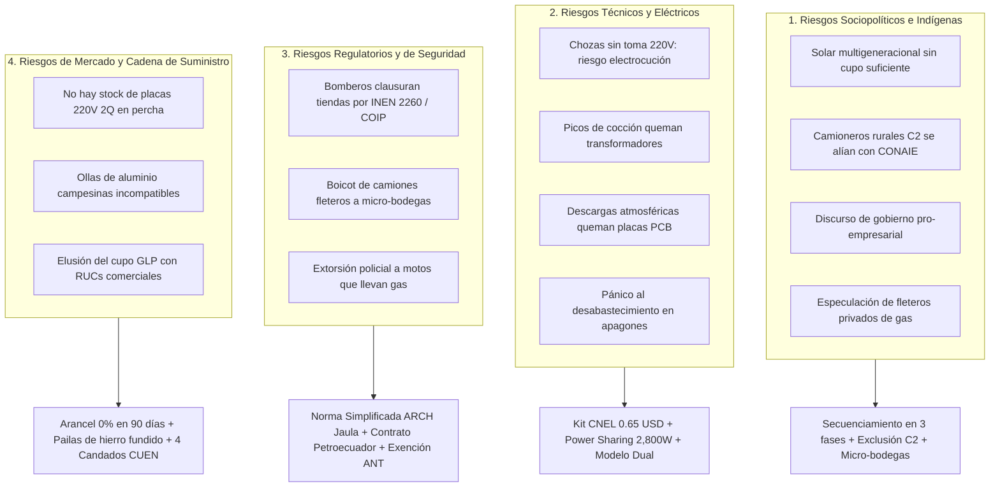
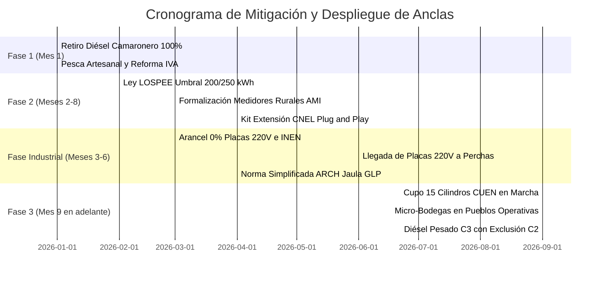

# Matriz de Riesgos Integrales, Vulnerabilidades Forenses y Estrategias de Mitigación

> **Consorcio Industrial Kronos — Red Team de Auditoría y Resiliencia Estratégica**  
> *Documento Canónico de Gestión de Riesgos — Proyecto Reformas Ecuador*  
> *Sujeto a la Doctrina Mandatoria de Operación (AGENTS.md) — Mandamientos 1, 3, 4, 5, 6 y 8.*

---

## 1. Misión y Propósito del Documento

Este documento consolida el mapa integral de **riesgos sociopolíticos, técnicos, regulatorios, logísticos y de mercado** identificados durante la auditoría forense al régimen de subsidios de combustibles, la transición a la cocción limpia rural y la descentralización del GLP.

El objetivo de esta matriz no es maquillar las debilidades del proyecto, sino **identificar con crudeza cada punto de falla potencial** y establecer la ingeniería de mitigación exacta (*hardware, software, legal y logística*) para asegurar que la reforma sea físicamente instalable, socialmente pacífica y económicamente auto-sostenible.

---

## 2. Mapa Sintético de Riesgos por Dimensión

---

## 3. Matriz Forense de Riesgos y Protocolos de Mitigación

A continuación se detalla cada riesgo individual, su probabilidad, nivel de impacto sistémico, la causa raíz del problema y la estrategia de ingeniería aplicada:

### Dimensión 1: Riesgos Sociopolíticos y Movilización Indígena (CONAIE)

| Código | Riesgo Identificado | Causa Raíz en Territorio | Impacto / Probabilidad | Estrategia de Mitigación y Manejo Kronos |
| :--- | :--- | :--- | :--- | :--- |
| **R-POL-01** | **Agotamiento del cupo GLP en solares multigeneracionales** | En el páramo, 3 o 4 familias conviven bajo un solo medidor eléctrico (12-16 personas). 15 cilindros/año se agotan en 4 meses. En el mes 5, el sistema exige 13.50 USD en efectivo, desatando asambleas comunales y cierre de la Panamericana Sur (E35). | **Catastrófico / Muy Alta** *(Detonante de paro nacional)* | **Secuenciamiento en 3 Fases:** La reforma eléctrica (Fase 2) castiga consumos residenciales mayores a 200/250 kWh a costo real, forzando económicamente a cada familia a solicitar su propio medidor independiente AMI antes de tocar el gas. En paralelo, el Art. 9 de la ley faculta a la Junta Parroquial a certificar cohabitación para asignar 15 cilindros adicionales por familia bajo el mismo solar. |
| **R-POL-02** | **Alianza de transportistas rurales C2 con la dirigencia indígena** | Camiones ligeros de 2 ejes (C2, 5-10 ton) pertenecientes a comuneros mueven papa, leche y legumbres a mercados populares. Subirles el diésel encarece el flete agrícola y une al transportista con la CONAIE. | **Alto / Alta** *(Repetición de Octubre 2019)* | **Exclusión Expresa de la Categoría C2:** Los camiones C2 rurales agrícolas/lecheros quedan expresamente congelados a 1.75 USD/galón junto con los buses de pasajeros. El ajuste del 10% anual aplica exclusivamente al transporte pesado comercial C3 y tractocamiones articulados C3S2 y C3S3 de flotas formales con cláusula obligatoria de pase de flete al cargador. |
| **R-POL-03** | **Discurso moral de "gobierno oligárquico que castiga a los pobres"** | La dirigencia indígena alega que el Estado sube el gas al campesino mientras subsidia a los exportadores y a las corporaciones. | **Alto / Alta** *(Pérdida de legitimidad política)* | **Fase 1 Inmediata de Sinceramiento Productivo:** Se elimina primero el 100% del subsidio al diésel camaronero de exportación (75 M USD/año) y el crédito fiscal de IVA para grandes empresas (135 M USD/año) sin tocar el GLP ni el diésel popular. Se despoja a la CONAIE de su bandera discursiva histórica. |
| **R-POL-04** | **Especulación del fletero privado de gas en el páramo** | El camión repartidor rural cobra 4.50 a 5.50 USD por subir caminos de tierra. Al subir el precio oficial 16.5 centavos, el fletero redondea abusivamente a 6.00 USD culpando al gobierno. | **Medio / Muy Alta** *(Malestar sordo en comunidades)* | **Red de Micro-Bodegas Rurales Comunitarias:** Descentralización de depósitos de 30 a 100 cilindros en tiendas de pueblo a PVP regulado de 2.26 USD en Año 1, permitiendo al campesino comprar a precio justo en su día de feria y ahorrarse más de 2.50 USD por cilindro. |

---

### Dimensión 2: Riesgos Técnicos y de Infraestructura Eléctrica Rural

| Código | Riesgo Identificado | Causa Raíz en Territorio | Impacto / Probabilidad | Estrategia de Mitigación y Manejo Kronos |
| :--- | :--- | :--- | :--- | :--- |
| **R-ELEC-01** | **Riesgo de electrocución o incendio por cables sueltos de 220V** | Las viviendas campesinas tienen instalaciones monofásicas precarias a 120V. Llevar 220V desde el medidor exterior a la cocina cuesta entre 45 y 70 USD. El campesino puede usar cables gemelos con cinta aislante en pisos húmedos de tierra. | **Crítico / Alta** *(Peligro vital para la población)* | **Kit Rural Plug & Play de CNEL:** La distribuidora eléctrica entrega e instala junto con el medidor nuevo una extensión prefabricada y sellada: 20 metros de cable encauchetado flexible 3x12 AWG con tomacorriente bipolar blindado NEMA 6-20. Costo: 22 USD financiado en la planilla a 0.65 USD/mes durante 36 meses sin intereses. |
| **R-ELEC-02** | **Saturación y colapso de transformadores rurales al mediodía** | Picos de demanda simultánea en recintos rurales donde 12 o 15 familias encienden placas de 3,500 W a las 11:30 am para el almuerzo (demanda de 40-50 kW sobre transformadores de 15 a 25 kVA). | **Alto / Alta** *(Apagones locales continuos)* | **Microcontrolador con Power Sharing Obligatorio:** Homologación técnica INEN que exige que la placa de 220V limite dinámicamente la potencia combinada a 2,800 W en cocción simultánea (Hornilla 1 a 1,800 W y Hornilla 2 a 1,000 W), reduciendo la demanda en un 20% y garantizando la estabilidad del transformador de poste. |
| **R-ELEC-03** | **Quema de placas electrónicas por descargas atmosféricas (rayos)** | Las tormentas andinas y amazónicas provocan sobretensiones transitorias destructivas que queman los transistores IGBT de las placas de inducción comunes. | **Medio / Muy Alta** *(Destrucción del equipo a los 6 meses)* | **Electrónica Tropicalizada Heavy-Duty:** Filtro de entrada con Varistores de Óxido Metálico (MOV) de alta absorción (mínimo 450 Joules), supresor TVS y fuente autorregulada con rango de operación dinámico de 175V a 250V. |
| **R-ELEC-04** | **Inseguridad alimentaria y rechazo cultural por miedo al apagón** | En el campo, un corte de luz por tormenta dura 24 a 48 horas. Exigir la entrega obligatoria del cilindro de gas deja a la familia sin comer y genera rechazo total a la inducción. | **Alto / Certeza (100%)** *(Fracaso del programa de 2014)* | **Modelo de Cocina Híbrida / Dual Resiliente:** Prohibición taxativa de decomisar el cilindro de gas. La familia conserva una hornilla tradicional de gas conectada a 1 cilindro como respaldo de emergencia. El 85% de la cocción se hace en inducción y 1 cilindro de gas dura de 6 a 8 meses. |

---

### Dimensión 3: Riesgos Regulatorios, Penales y de Seguridad en GLP

| Código | Riesgo Identificado | Causa Raíz en Territorio | Impacto / Probabilidad | Estrategia de Mitigación y Manejo Kronos |
| :--- | :--- | :--- | :--- | :--- |
| **R-REG-01** | **Clausura de tiendas rurales y cárcel bajo el Art. 264 del COIP** | La Norma INEN 2260 y el Reglamento de Bomberos prohíben almacenar gas junto a víveres. El COIP sanciona con 1 a 3 años de prisión el almacenamiento no autorizado de hidrocarburos. Ningún tendero de pueblo aceptará vender gas si arriesga la cárcel. | **Catastrófico / Muy Alta** *(Parálisis total del esquema de micro-bodegas)* | **Norma Técnica Simplificada ARCH-Bomberos:** Aprobación del estándar de "Jaula Metálica Exterior Homologada" (malla galvanizada, techo de zinc, extintor de 20 lb y candado en patio ventilado para hasta 60 cilindros). Licenciamiento automático web en 48 horas vía declaración juramentada, amparando legalmente al comerciante. |
| **R-REG-02** | **Boicot de abastecimiento por los camiones repartidores privados** | Los dueños de los camiones fleteros se niegan a vender cilindros mayoristas a la tienda de pueblo para forzar a los campesinos a seguir pagando 5.00 USD en la carretera. | **Alto / Muy Alta** *(Desabastecimiento artificial en el pueblo)* | **Obligación Contractual con Revocatoria de Cupo:** La ARCH y Petroecuador fijan como obligación inexcusable en los contratos de los distribuidores el abastecimiento prioritario a las micro-bodegas registradas. La Junta Parroquial denuncia desabastecimientos en la app y se suspende de inmediato el cupo del distribuidor infractor. |
| **R-REG-03** | **Extorsión y multas policiales a campesinos en motocicletas** | Agentes de tránsito de la CTE o Policía Nacional multan a campesinos que transportan su cilindro de gas en moto o burro por vías provinciales alegando "transporte peligroso". | **Medio / Alta** *(Afectación económica al comunero)* | **Reforma Expresa al Reglamento de la ANT:** Decreto Ejecutivo que añade una disposición general en el Reglamento de Tránsito autorizando expresamente el transporte doméstico unifamiliar de hasta 1 cilindro de 15 kg en motos con soporte o parrilla adecuada y camionetas comunitarias rurales. |

---

### Dimensión 4: Riesgos de Cadena de Suministro y Factibilidad de Mercado

| Código | Riesgo Identificado | Causa Raíz en Territorio | Impacto / Probabilidad | Estrategia de Mitigación y Manejo Kronos |
| :--- | :--- | :--- | :--- | :--- |
| **R-MKT-01** | **Inexistencia de placas de 220V 2Q sobremesa en perchas comerciales** | En almacenes de electrodomésticos solo hay placas de 110V o empotrables caras de 4Q de 300 USD. No hay oferta masiva de placas portátiles de 220V con marco de acero inoxidable. | **Alto / Certeza (100%)** *(Inaplicabilidad inmediata)* | **Arancel 0%, IVA 0% y Homologación INEN en 15 Días:** Estímulo arancelario y tributario inmediato para fabricantes locales (Indurama, Fibroacero) e importadores mayoristas de kits CKD, generando oferta masiva en percha a un PVP regulado de 75 a 85 USD en un plazo de 90 a 120 días. |
| **R-MKT-02** | **Incompatibilidad del menaje andino tradicional (ollas de aluminio)** | El 95% del menaje campesino es de aluminio fundido artesanal que no funciona en inducción. Comprar ollas importadas de acero inoxidable cuesta más de 100 USD. | **Alto / Certeza (100%)** *(Rechazo de uso del equipo)* | **Kits Comunales de Hierro Fundido y Peltre Grueso:** Fomento de juegos de dos piezas (paila de hierro de 26 cm para tostado y fritadas + olla arrocera/sopera de peltre de 5 litros con base ferromagnética plana de 4 mm) a costo al por mayor de 22 a 28 USD, compatibles con inducción, leña y gas. |
| **R-MKT-03** | **Fraude, acopio y desvío comercial de cilindros subsidiados** | Restaurantes, hoteles y calderas industriales intentan comprar gas subsidiado a través de cédulas de campesinos o compras masivas. | **Alto / Muy Alta** *(Fuga de recursos fiscales)* | **Los Cuatro Candados Anti-Fraude CUEN:** Cadencia temporal de 20 días entre cilindros, canje físico 1:1 con SMS de alerta transaccional al titular del medidor, consumo eléctrico mínimo activo de 15 kWh/mes y geocercas satelitales GPS en camiones distribuidores con bloqueo multi-drop en RUCs comerciales. |

---

## 4. Cronograma Crítico de Mitigación y Puntos de Decisión (Go / No-Go)

Para garantizar que ningún riesgo se materialice, la implementación sigue una secuencia de hitos obligatorios:

---

## 5. Bitácora Forense de Decisiones de Mitigación (Mandamiento 6)

| Alternativa de Mitigación Evaluada | Decisión | Pros Identificados | Contras y Trade-offs | Justificación Técnica Exacta del Descarte |
| :--- | :--- | :--- | :--- | :--- |
| **Ignorar la falta de placas 220V y dejar que el mercado las traiga** | **Descartada** | Cero costo fiscal en incentivos arancelarios. | Desabastecimiento total en perchas; especulación con precios de más de 180 USD; paralización del programa. | Descartada. Sin oferta masiva en percha a precio regulado, el campesino no tiene opción de compra. |
| **Exigir la entrega obligatoria del cilindro de gas para dar la placa** | **Descartada** | Ahorro fiscal del 100% en subsidio de gas de esa familia. | Pánico al desabastecimiento por cortes de luz; rechazo total del campesinado; reactivación de protestas de la CONAIE. | Descartada. La seguridad energética familiar es sagrada. El gas debe coexistir como respaldo de contingencia. |
| **Permitir almacenamiento de gas dentro de tiendas de abarrotes comunes** | **Descartada** | Simplicidad inmediata para el tendero rural. | Riesgo grave de explosión por coexistencia con fósforos, alcohol y velas; clausura inevitable de Bomberos; riesgo de cárcel por COIP. | Descartada por seguridad industrial y blindaje legal del comerciante. Se aprueba exclusivamente la jaula metálica exterior ventilada. |
| **Kit Rural Plug & Play de CNEL financiado en planilla (0.65 USD/mes)** | **Aprobada** | Elimina el peligro mortal de cables sueltos en pisos de tierra; garantiza calibre 12 AWG y toma NEMA 6-20 segura; costo imperceptible para el hogar. | Requiere que CNEL mantenga stock de extensiones encauchetadas. | Aprobada como la única solución técnica que garantiza seguridad física sin costos prohibitivos de entrada para el usuario. |
| **Microcontrolador con Power Sharing (2,800 W) en Placas Homologadas** | **Aprobada** | Protege los transformadores rurales de sobrecargas al mediodía; evita disparos de cañuelas en postes; permite cocción simultánea rápida. | Requiere incorporar el firmware de modulación de potencia en fábrica. | Aprobada. Soluciona el cuello de botella de la red eléctrica rural sin exigir una repotenciación multimillonaria e inmediata de todos los transformadores de CNEL. |

---

### Registro Pericial

El presente documento constituye el **mapa de control de riesgos canónico** del proyecto Reformas Ecuador. Cualquier ajuste futuro en regulaciones, especificaciones técnicas de línea blanca o convenios interinstitucionales deberá ser confrontado contra los riesgos aquí catalogados para preservar la estabilidad operativa del modelo.
